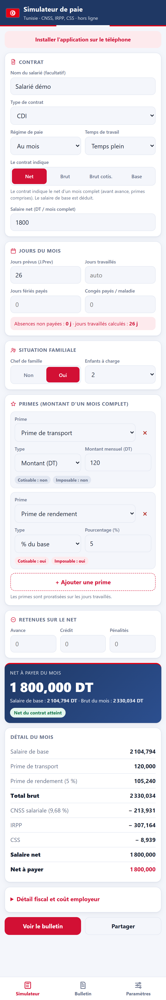
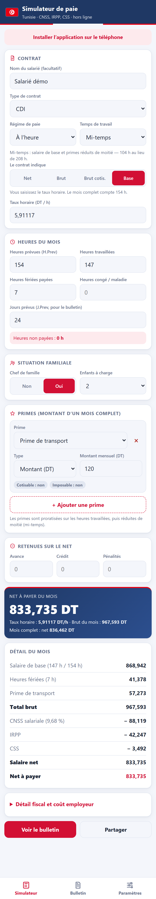
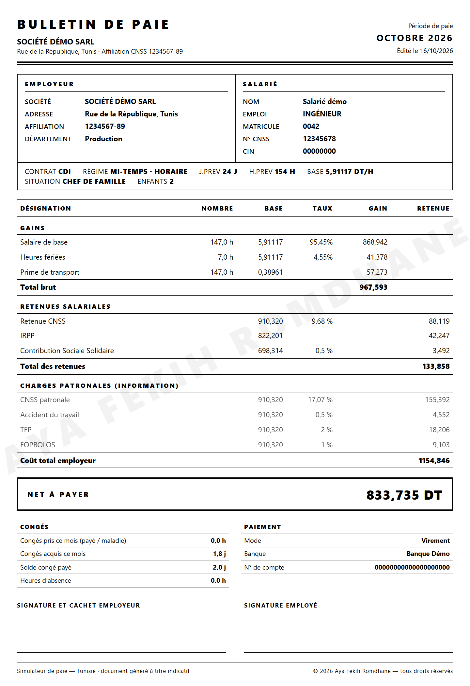
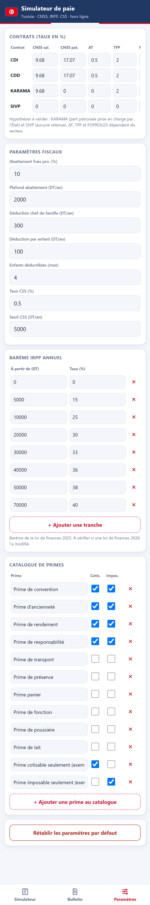

# Simulateur de paie — Tunisie

Application web de simulation de paie tunisienne : saisie d'un salaire **net**, **brut**, **brut cotisable** ou **de base**, et calcul complet des cotisations CNSS, de l'IRPP, de la CSS et du coût employeur, jusqu'au **bulletin de paie imprimable**.

Elle fonctionne **hors ligne** et s'installe sur téléphone comme une application (PWA).

**Application en ligne : [aya-fekih-romdhane.github.io/Paie-Simulator](https://aya-fekih-romdhane.github.io/Paie-Simulator/)**

---

## Aperçu

### Simulateur

Saisie du contrat, des jours du mois, de la situation familiale et des primes. Le résultat se met à jour à chaque frappe.



Ci-dessus, le mode **Net** : on saisit le net voulu (1 800 DT), l'application remonte au salaire de base correspondant (2 104,794 DT) par recherche dichotomique au millime, et confirme que le net du contrat est atteint.

### Régime horaire et mi-temps



En régime horaire, le mois se compte en heures (`H.Prev`) et le salaire de base se saisit en **taux horaire**. En mi-temps, le salaire de base et les primes sont réduits de moitié et le mois passe à **104 h au lieu de 208 h**.

### Bulletin de paie

Modèle **noir et blanc**, prêt à imprimer ou à exporter en PDF depuis le navigateur. Le nom de l'auteur apparaît en filigrane en fond de page et la mention de droit d'auteur en pied de document — à l'écran comme à l'impression.



### Paramètres

Tous les taux et barèmes sont modifiables dans l'application, sans toucher au code.



---

## Fonctionnalités

### Quatre modes de saisie

Le contrat peut indiquer n'importe lequel de ces quatre montants ; l'application retrouve les trois autres.

| Mode | Le contrat indique |
|------|--------------------|
| **Net** | le salaire net d'un mois complet, avant avance et primes comprises |
| **Brut** | le brut total (salaire de base + primes) |
| **Brut cotisable** | le salaire de base + les primes cotisables uniquement |
| **Base** | directement le salaire de base mensuel (ou le taux horaire en régime horaire) |

### Types de salarié

- **Type de contrat** : CDI, CDD, KARAMA, SIVP — chacun avec ses propres taux de cotisation.
- **Régime de paie** : au mois (compté en jours) ou à l'heure (compté en heures).
- **Temps de travail** : temps plein ou mi-temps.

### Jours et heures du mois

Jours prévus (`J.Prev`), jours travaillés, jours fériés payés, congés payés / maladie — les absences non payées sont déduites automatiquement. En régime horaire, les mêmes rubriques sont comptées en heures (`H.Prev`).

Les jours travaillés sont calculés automatiquement si on laisse le champ vide.

### Primes

Catalogue de primes courantes, chacune marquée **cotisable** et/ou **imposable** :

- Prime de convention, d'ancienneté, de rendement, de responsabilité — cotisables et imposables
- Prime de transport, de présence, panier, de fonction, de poussière, de lait — ni cotisables ni imposables

Chaque prime se saisit en montant fixe ou en pourcentage du salaire de base, et se proratise sur le temps travaillé.

### Retenues sur le net

Avance, remboursement de crédit et pénalités sont déduits après le calcul du net.

### Bulletin de paie

Bulletin au format tunisien : en-tête société et salarié, tableau des gains et retenues avec part patronale, net à payer en dinars, mode de paiement, zones de signature et suivi des congés. Imprimable directement ou exportable en PDF.

Mise en page sobre en noir et blanc : gains, retenues salariales et charges patronales regroupés par section avec leur total, net à payer en encadré, congés et paiement en pied de page. Le filigrane au nom de l'auteur et la mention de droit d'auteur sont conservés à l'impression comme à l'affichage.

### Paramètres modifiables

Taux de cotisation par contrat, barème IRPP, abattement, déductions familiales, seuil et taux de CSS, catalogue des primes : tout est éditable dans l'onglet Paramètres et conservé dans le navigateur. Un bouton permet de rétablir les valeurs par défaut.

### Application hors ligne

Installable sur téléphone comme une application native (PWA). Le service worker sert la dernière version en ligne quand le réseau est disponible, et bascule sur le cache hors ligne.

---

## Règles de calcul

### Enchaînement

```
salaire de base (mois complet, temps plein)
  × quotité (1 ou 0,5)            → mi-temps : moitié du salaire et des primes
  × unités travaillées / prévues  → prorata jours ou heures
  + primes (proratisées)
  = BRUT  /  BRUT COTISABLE  /  BRUT IMPOSABLE

brut cotisable × taux CNSS salarial     = retenue CNSS
brut imposable − retenue CNSS           = salaire imposable mensuel
  × 12                                  = revenu annuel imposable
  − abattement 10 % (plafonné)
  − déductions familiales
  = revenu net imposable (RNI)
  → barème IRPP progressif → ÷ 12       = IRPP mensuel
  → CSS si RNI au-dessus du seuil       = CSS mensuelle

brut − CNSS − IRPP − CSS                = SALAIRE NET
  − avance − crédit − pénalités         = NET À PAYER
```

Tous les montants sont arrondis au millime (3 décimales), demi vers l'infini, comme la fonction `ROUND` d'Excel.

### Taux par type de contrat

| Contrat | CNSS salarié | CNSS patronale | Accident du travail | TFP | FOPROLOS | IRPP | CSS |
|---------|-------------:|---------------:|--------------------:|----:|---------:|:----:|:---:|
| CDI | 9,68 % | 17,07 % | 0,50 % | 2 % | 1 % | oui | oui |
| CDD | 9,68 % | 17,07 % | 0,50 % | 2 % | 1 % | oui | oui |
| KARAMA | 9,68 % | — | — | 2 % | 1 % | oui | oui |
| SIVP | — | — | — | — | — | non | non |

### Barème IRPP (revenu annuel net imposable)

| Tranche | Taux |
|---------|-----:|
| jusqu'à 5 000 DT | 0 % |
| de 5 000 à 10 000 DT | 15 % |
| de 10 000 à 20 000 DT | 25 % |
| de 20 000 à 30 000 DT | 30 % |
| de 30 000 à 40 000 DT | 33 % |
| de 40 000 à 50 000 DT | 36 % |
| de 50 000 à 70 000 DT | 38 % |
| au-delà de 70 000 DT | 40 % |

### Abattement, déductions et CSS

| Élément | Valeur par défaut |
|---------|-------------------|
| Abattement sur frais professionnels | 10 % du revenu annuel, plafonné à 2 000 DT |
| Chef de famille | 300 DT par an |
| Enfant à charge | 100 DT par an, dans la limite de 4 enfants |
| Contribution Sociale Solidaire (CSS) | 0,5 % du RNI, au-delà de 5 000 DT de RNI |

### Prorata et mi-temps

- **Au mois** : chaque rubrique vaut `salaire de base ÷ jours prévus × nombre de jours`.
- **À l'heure** : le taux horaire est rapporté à un mois plein de **208 h** (48 h par semaine) ; chaque rubrique vaut `taux horaire × nombre d'heures`.
- **Mi-temps** : salaire de base et primes réduits de moitié ; en régime horaire, le mois complet passe à **104 h** au lieu de 208 h.

Le mois complet de référence garde le régime et la quotité du salarié : pour un mi-temps, un mois complet reste un mi-temps.

---

## Utilisation

### En ligne

Ouvrir [aya-fekih-romdhane.github.io/Paie-Simulator](https://aya-fekih-romdhane.github.io/Paie-Simulator/), puis l'ajouter à l'écran d'accueil pour l'utiliser hors ligne :

- **Android, Chrome, Edge** : le bouton **Installer l'application sur le téléphone** s'affiche en haut de l'écran.
- **iPhone et iPad** : iOS n'expose aucune API d'installation — Safari ne peut donc pas afficher ce bouton. L'ajout se fait par **Partager** puis **Sur l'écran d'accueil**. L'application affiche d'elle-même cette consigne lorsqu'elle est ouverte sur iOS.

### En local

Le projet n'a ni dépendance ni étape de compilation. Il suffit de le servir en HTTP (le service worker ne fonctionne pas en `file://`) :

```bash
git clone https://github.com/Aya-Fekih-Romdhane/Paie-Simulator.git
cd Paie-Simulator
npx http-server -p 8080
```

Puis ouvrir `http://localhost:8080`.

---

## Structure du projet

```
Paie-Simulator/
├── index.html              interface complète (simulateur, bulletin, paramètres) et styles
├── calc.js                 moteur de calcul, utilisable seul
├── manifest.webmanifest    manifeste PWA
├── sw.js                   service worker (réseau d'abord, cache en secours)
├── icon-192.png            icônes de l'application
├── icon-512.png
├── icon-maskable-512.png
└── docs/screenshots/       captures d'écran du README
```

### Le moteur de calcul

`calc.js` est autonome et utilisable en dehors de l'interface, dans le navigateur (`window.WP`) comme avec Node :

```js
const WP = require('./calc.js');

const resultat = WP.solve('net', 1800, {
  params: WP.DEFAULT_PARAMS,
  contract: 'CDI',
  regime: 'mensuel',      // ou 'horaire'
  quotite: 1,             // 0.5 pour un mi-temps
  chef: true,
  enfants: 2,
  days: { prev: 26, trav: '', feries: 0, conges: 0 },
  primes: [{ name: 'Transport', cot: false, imp: false, mode: 'fixed', value: 120 }],
  avance: 0, credit: 0, penal: 0
});

console.log(resultat.base, resultat.brut, resultat.net, resultat.netAPayer);
```

Principales fonctions exposées : `solve`, `solveBase`, `compute`, `normDays`, `normHours`, `normQuotite`, ainsi que `DEFAULT_PARAMS`, `MODES`, `REGIMES` et `HOURS_FULL`.

---

## Technologies

HTML, CSS et JavaScript natifs — aucun framework, aucune dépendance, aucune compilation. Progressive Web App (manifeste et service worker), données conservées en `localStorage`, hébergement GitHub Pages.

Interface aux couleurs de la Tunisie : drapeau en en-tête, filet rouge et blanc, rouge tunisien en couleur d'accent et icônes de section dessinées en SVG. Aucune image externe n'est chargée — l'application et le bulletin restent entièrement autonomes et imprimables hors ligne.

---

## Limites

Cet outil est un **simulateur à titre indicatif**. Les taux, barèmes et plafonds livrés par défaut doivent être vérifiés avant toute utilisation en paie réelle, et restent modifiables dans l'onglet Paramètres. De légers écarts d'arrondi (de l'ordre du millime) peuvent apparaître par rapport à un logiciel de paie, selon l'ordre des arrondis appliqués dans la chaîne de calcul.

---

## Auteur

**Aya Fekih Romdhane** — conception, développement et création du site.

- GitHub : [@Aya-Fekih-Romdhane](https://github.com/Aya-Fekih-Romdhane)
- Contact : fekih.aya@gmail.com

Projet développé et maintenu par Aya Fekih Romdhane.

© 2026 Aya Fekih Romdhane — tous droits réservés.
